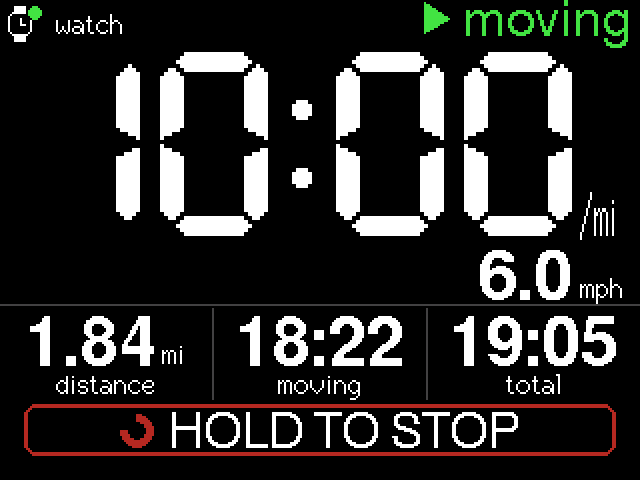
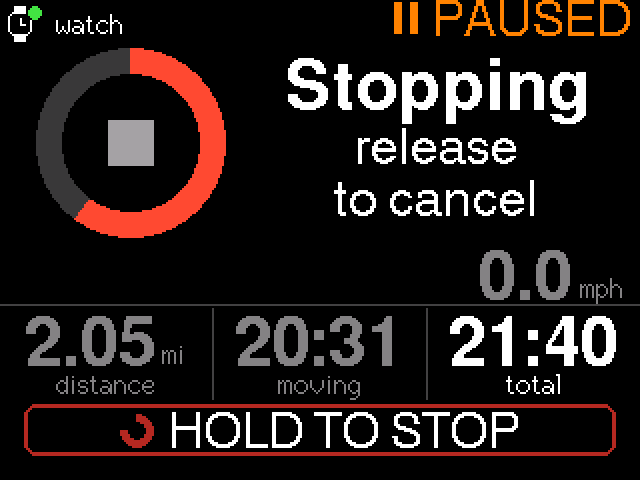
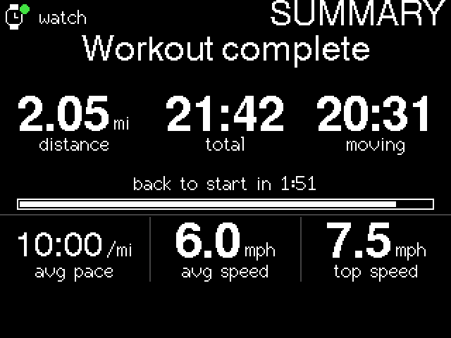

# OpenTread User Guide (1.0.0)

OpenTread is an open-source replacement console for the AssaultRunner curved
manual treadmill. A CYD board (ESP32 + 2.8" touch screen) reads the treadmill's
speed sensor directly, shows your workout, and broadcasts it over Bluetooth as
`OpenTread`: a running footpod (RSC) for your watch and an FTMS treadmill for
apps.

## 1. Install

Hardware, wiring and flashing are covered in the [README](../README.md). The
points below are the ones that matter for safety and day-to-day reliability.

**Wiring (CYD CN1 connector to your solder tap on the console's sensor socket):**

| CYD CN1 | Tap wire |
|---|---|
| GND | sensor **GND** |
| GPIO 27 | sensor **SIG** |
| GPIO 22, 3.3V | not connected |

- **Check the wires with a meter before connecting.** With the console powered
  and the black probe on the GND wire, SIG reads about **+3.2 V** and drops to
  0 V when the reed closes. If GND and SIG are swapped, the CYD may still count
  pulses, but the stock console stops seeing the belt.
- **Never connect the console's 3.3 V to the CYD.** Two regulators would fight.
- **Power the CYD with a 5 V USB wall adapter (at least 1 A)** and a cable that
  fits its port. Route the cable away from the belt and slats.

**Stock console:**

- **Simplest: leave it connected in parallel.** It keeps working and doesn't
  interfere. Its Bluetooth only turns on if you press CONNECT.
- **If you remove it:** the CYD's internal pull-up has to hold the line high on
  its own. This hasn't been tested. If distance or speed look wrong, or nothing
  counts, solder a **10 kΩ resistor from GPIO 27 to 3.3 V** on the CYD side, or
  plug the console back in.

## 2. Pair your watch or app

- **Garmin:** Settings → Sensors & Accessories → Add New → **Foot Pod** →
  `OpenTread`. Leave calibration at 100%.
- **Other watches:** pair `OpenTread` as a Bluetooth running footpod (speed and
  cadence sensor).
- **Apps:** connect to the FTMS treadmill called `OpenTread`.

## 3. Daily use

|  |  |  |
|:-:|:-:|:-:|
| Running | Hold to stop | Summary |

- **Start:** just start moving. After **5 s** of continuous movement the
  workout starts (WARM-UP, then ▶ moving). Those first seconds aren't counted.
- **Screen:**
  - big **pace**, with **speed** under it
  - **distance**, **moving time** and **total time**
  - a watch icon at the top left, lit when a watch or app is connected
- **Pause:** stop moving. After **2.5 s** it shows ⏸ PAUSED: moving time stops
  and total time keeps running. Start moving again to resume.
- **Switch units** (mi and mph, or km and km/h): **tap the big pace number**.
  The choice is saved and survives power-off.
- **Stop:** **press and hold the HOLD TO STOP strip** at the bottom for **2 s**
  (a ring fills). Let go early to cancel. Only the strip starts a stop, so
  resting a hand on the numbers does nothing.
- **Summary:** shown for **2 min** after a stop: distance, total time, moving
  time, average pace, average speed and top speed.
  - A new workout won't start until the belt has been **still for 2.5 s**. If
    you're still moving, the idle screen says "Stop the belt to start again".
- **Auto-end:** after **15 min** with no movement, the workout ends by itself
  and the summary is shown.
- **Screen sleep:**
  - **dims after 60 s** and **turns off after 5 min** with no movement and no
    touch
  - moving the belt or touching the screen wakes it
  - on a **dimmed** screen, touches work normally; on a screen that is **off**,
    the first touch only wakes it
  - the workout stays open while the screen is off
- **Recording on your watch:** start a **Treadmill** activity as usual. The
  watch records speed and distance from OpenTread, and heart rate itself. The
  watch's start/stop is separate from the console's, so start and stop each one
  yourself.

## 4. About the distance

OpenTread shows **true belt travel**: it counts the belt's reed sensor at
**0.5974 m per pulse** (one pulse per 10 slats). The stock console reads about
**14% higher** for the same run, so expect your OpenTread distances to be
shorter than the ones you're used to.

## 5. Reporting a problem

A log is the most useful thing you can send. Plug the CYD into a computer over
USB (at the treadmill, still wired to the sensor), then from the repo folder:

```bash
python3 -m venv .venv && .venv/bin/pip install -r requirements.txt   # one time
.venv/bin/python tools/capture.py --port <port> --session <short_name>
```

`<port>` is the CYD's serial port (`/dev/cu.usbserial-*` on macOS,
`/dev/ttyUSB0` on Linux, `COMx` on Windows). Reproduce the problem, then press
Ctrl-C. The log is saved as `logs/<date>_<time>_<short_name>.csv` and records
every pulse, state change, touch and Bluetooth event.

Optionally, check it yourself:

```bash
.venv/bin/python tools/replay.py logs/<file>.csv
```

Then open an issue at <https://github.com/scottjulian/OpenTread/issues>,
describe what happened and roughly when, and attach the log. Without a log, a
description with the time it happened still helps.

Known things to watch for:

- **Wet or sweaty fingers** can make a hold cancel early. If that happens to
  you, please report it: the hold can be made more tolerant of brief contact
  dropouts.
- **Not yet tested on a real belt:** very fast sprints (above about 6 pulses/s,
  roughly 13 km/h) and running with the stock console removed (see the pull-up
  note above).

## 6. Going back

To go back to the stock console, plug it back in (or just unplug the CYD). If
you left it connected in parallel, it never stopped working.
